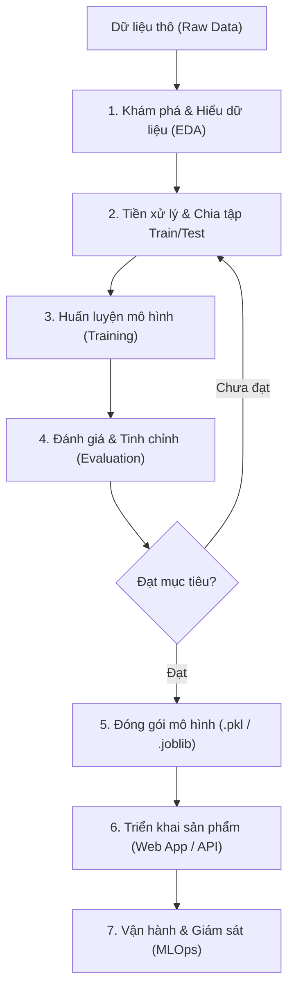

# Quy Trình Phát Triển Dự Án Machine Learning Thực Tế (End-to-End ML Pipeline)

Tài liệu này tổng hợp toàn bộ các bước tiêu chuẩn từ khi có dữ liệu thô cho đến khi triển khai thành một sản phẩm thực tế trong Machine Learning, đồng thời tích hợp ghi chú cho quy trình làm việc giữa **VSCode (Local)**, **GitHub** và **Kaggle**.

---

## 1. Sơ Đồ Luồng Tổng Quan



---

## 2. Chi Tiết Từng Giai Đoạn

### Giai Đoạn 1: Khám Phá & Thấu Hiểu Dữ Liệu (Exploratory Data Analysis - EDA)
*Mục tiêu: Hiểu rõ cấu trúc, đặc điểm và chất lượng của tập dữ liệu trước khi làm bất kỳ bước nào khác.*
- **Kiểm tra tổng quan:**
  - Kích thước ma trận (`shape`), tên cột, kiểu dữ liệu từng cột (`dtypes`).
  - Kiểm tra giá trị bị khuyết (`isna().sum()`, `isnull()`).
- **Thống kê mô tả:**
  - Xem phân phối số học: giá trị lớn nhất, nhỏ nhất, trung bình (mean), trung vị (median), độ lệch chuẩn (`describe()`).
- **Trực quan hóa dữ liệu (Data Visualization):**
  - **Scatter Plot (Biểu đồ phân tán):** Quan sát tương quan giữa biến độc lập ($X$) và biến phụ thuộc ($y$). Kiểm tra xem xu hướng là tuyến tính (linear) hay phi tuyến (non-linear).
  - **Box Plot / Histogram:** Phát hiện các điểm dị biệt (**Outliers**) và kiểm tra độ lệch của phân phối (Skewness).
- **Thư viện thường dùng:** `pandas`, `numpy`, `matplotlib`, `seaborn`.

---

### Giai Đoạn 2: Tiền Xử Lý & Chuẩn Bị Dữ Liệu (Data Preprocessing)
*Mục tiêu: Đưa dữ liệu về dạng sạch nhất và chia tách hợp lý để mô hình học khách quan.*
- **Làm sạch (Data Cleaning):**
  - Xử lý ô trống: Điền giá trị trung bình/trung vị (Imputation) hoặc loại bỏ hàng thiếu nếu lượng thiếu rất nhỏ.
  - Xử lý ngoại lai (Outliers): Loại bỏ hoặc dùng kỹ thuật cắt ngưỡng (clipping) nếu ngoại lai là do lỗi nhập liệu.
- **Tách biến:**
  - $X$: Tập hợp các đặc trưng đầu vào (Features) – ví dụ: `YearsExperience`.
  - $y$: Biến mục tiêu cần dự đoán (Target) – ví dụ: `Salary`.
- **Chia tập dữ liệu (Train/Test Split):**
  - Nguyên tắc cốt lõi: **Không bao giờ đánh giá mô hình trên dữ liệu nó đã học**.
  - Tỉ lệ phân chia thông dụng: 80% Train - 20% Test (hoặc 70% - 30%).
- **Chuẩn hóa / Co giãn đặc trưng (Feature Scaling) (nếu cần):**
  - Sử dụng `StandardScaler` hoặc `MinMaxScaler` khi mô hình nhạy cảm với độ lớn của dữ liệu (như Gradient Descent, KNN, SVM, Neural Networks). Với Simple Linear Regression trên 1 biến, bước này có thể không làm đổi nghiệm nhưng vẫn là kỹ năng chuẩn.
- **Thư viện thường dùng:** `scikit-learn` (`train_test_split`, `StandardScaler`).

---

### Giai Đoạn 3: Huấn Luyện Mô Hình (Model Building & Training)
*Mục tiêu: Cho thuật toán học mối quan hệ giữa biến đầu vào $X$ và biến mục tiêu $y$.*
- **Chọn mô hình cơ sở (Baseline Model):**
  - Với bài toán dự đoán giá trị liên tục (như mức lương), bắt đầu bằng **Linear Regression**:
    $$\hat{y} = w \cdot x + b$$
    Trong đó:
    - $w$ (Weight / Slope): Hệ số góc, thể hiện mỗi năm kinh nghiệm tăng thêm thì lương tăng bao nhiêu.
    - $b$ (Bias / Intercept): Điểm cắt trục tung (mức lương cơ sở khi kinh nghiệm = 0).
- **Mở rộng & Thử nghiệm thêm:**
  - Khi bài toán phức tạp hơn: Thử thêm Ridge/Lasso Regression, Polynomial Regression, Decision Tree Regressor, Random Forest Regressor.
- **Thư viện thường dùng:** `sklearn.linear_model.LinearRegression`.

---

### Giai Đoạn 4: Đánh Giá & Tinh Chỉnh Mô Hình (Model Evaluation)
*Mục tiêu: Đo lường chính xác năng lực dự đoán trên tập dữ liệu chưa từng thấy (Test Set).*
- **Các chỉ số đánh giá (Evaluation Metrics) chuẩn cho Regression:**
  - **MAE (Mean Absolute Error):** Trung bình độ lệch tuyệt đối giữa thực tế và dự đoán.
    $$\text{MAE} = \frac{1}{n} \sum_{i=1}^n |y_i - \hat{y}_i|$$
  - **MSE (Mean Squared Error) / RMSE (Root MSE):** Bình phương sai số, phạt nặng các lỗi dự đoán sai lệch lớn.
    $$\text{RMSE} = \sqrt{\frac{1}{n} \sum_{i=1}^n (y_i - \hat{y}_i)^2}$$
  - **$R^2$ Score (Hệ số xác định):** Biểu thị tỷ lệ phần trăm sự biến thiên của biến phụ thuộc được giải thích bởi mô hình. Giá trị càng tiến gần $1.0$ càng tốt.
- **Kiểm tra hiện tượng Underfitting / Overfitting:**
  - **Underfitting:** Cả Train và Test đều sai số cao (mô hình quá đơn giản).
  - **Overfitting:** Train sai số rất thấp nhưng Test sai số cao (mô hình học vẹt dữ liệu train).
- **Trực quan hóa kết quả:** Vẽ biểu đồ đường hồi quy cùng các điểm dữ liệu thực tế trên tập Test.

---

### Giai Đoạn 5: Đóng Gói Mô Hình (Model Serialization)
*Mục tiêu: Lưu lại mô hình đã huấn luyện thành tệp để sử dụng bất cứ lúc nào mà không cần train lại.*
- **Cách thức:**
  - Lưu đối tượng mô hình (`model`) thành file nhị phân (thường là `.joblib` hoặc `.pkl`).
  - Khi có dự đoán mới, chỉ cần nạp lại file (`joblib.load()`) và gọi hàm `predict()`.
- **Thư viện thường dùng:** `joblib`, `pickle`.

---

### Giai Đoạn 6: Xây Dựng Sản Phẩm Hoàn Chỉnh (Deployment & Serving)
*Mục tiêu: Đưa mô hình tới tay người dùng cuối hoặc kết nối vào hệ thống phần mềm.*
- **Lựa chọn 1 - Giao diện Web tương tác nhanh (Demo / PoC):**
  - Sử dụng **Streamlit** hoặc **Gradio**.
  - Thiết kế ô nhập số năm kinh nghiệm $\rightarrow$ Bấm nút "Dự đoán" $\rightarrow$ Hiển thị mức lương dự tính trực quan kèm biểu đồ.
- **Lựa chọn 2 - Backend REST API (Sản xuất thực tế / Microservices):**
  - Sử dụng **FastAPI** hoặc **Flask**.
  - Cung cấp endpoint: `POST /api/v1/predict-salary`.
  - Phù hợp khi cần tích hợp với Frontend (React, Vue, Mobile App iOS/Android).
- **Lựa chọn 3 - Triển khai lên đám mây (Cloud Hosting):**
  - Đóng gói bằng **Docker**.
  - Đưa lên Hugging Face Spaces, Render, AWS, GCP hoặc Azure.

---

### Giai Đoạn 7: Vận Hành & Giám Sát (MLOps & Monitoring)
*Mục tiêu: Đảm bảo mô hình luôn hoạt động chính xác trong môi trường thực tế.*
- **Data Drift & Concept Drift:**
  - Lương trên thị trường thay đổi theo thời gian do lạm phát, xu hướng công nghệ. Mô hình huấn luyện năm 2024 có thể không còn chuẩn xác cho năm 2026.
- **Kế hoạch cập nhật:**
  - Thu thập dữ liệu phản hồi mới và định kỳ huấn luyện lại (Retrain) mô hình.

---

## 3. Ghi Chú Workflow Thực Chiến: VSCode $\rightarrow$ GitHub $\rightarrow$ Kaggle

Khi bạn phát triển code trên máy cá nhân (VSCode) và dùng tài nguyên tính toán của Kaggle:

1. **Tại máy cục bộ (VSCode):**
   - Viết các đoạn mã rõ ràng, chia file module hóa (ví dụ: `data_loader.py`, `train.py`, `evaluate.py`).
   - Sử dụng Git để commit và push code lên GitHub:
     ```bash
     git add .
     git commit -m "feat: complete linear regression training script"
     git push origin main
     ```
2. **Tại môi trường Kaggle:**
   - Trong một Kaggle Notebook, clone repo về workspace của Kaggle:
     ```bash
     !git clone https://github.com/<username>/<repo_name>.git
     ```
   - Trỏ đường dẫn dữ liệu đến thư mục `/kaggle/input/...` mà bạn đã thêm vào notebook.
   - Chạy script huấn luyện và lưu output file model (`.joblib`) vào `/kaggle/working/`.
   - Tải file model `.joblib` về hoặc dùng Kaggle Output Dataset để sử dụng tiếp cho bước Deployment.
